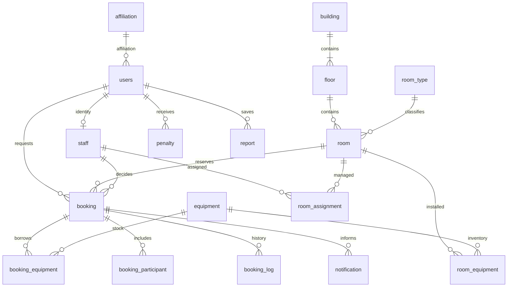

# ผลปรับเว็บและฐานข้อมูลตาม Term Project — 12 ตุลาคม 2569

อ้างอิง `../../Request/Term Project_เบส_888.pdf` หน้า 3–21 ตรวจและติดตั้งใน Supabase project `dvdjnociifxfhqkcqqsr` (KKU Space)

## โครงสร้างที่ติดตั้งจริง

เพิ่ม schema `kku_booking` ครบ 18 ตารางตาม ER/DDL ของรายงาน มี Foreign Key 26 จุด และเปิด RLS ทุกตาราง ข้อบังคับทุกตัว validated แล้ว Security Advisor ไม่พบ lints หลังติดตั้ง

| ตารางใน PDF / ตารางจริงใน kku_booking | การเชื่อมกับเว็บ |
| --- | --- |
| affiliation | แยกสังกัดจากข้อมูลผู้ใช้ ไม่สร้างสังกัดปลอมให้ผู้ใช้ที่ยังไม่ระบุ |
| users | ชื่อ อีเมล เบอร์ บทบาท สถานะ และ audit/soft delete |
| staff | เชื่อม users แบบหนึ่งต่อหนึ่ง เก็บเจ้าหน้าที่เดิมไว้สำหรับประวัติอนุมัติแม้เปลี่ยนบทบาท |
| building | อาคาร พร้อม audit/soft delete |
| floor | ชั้นแยกพร้อม FK อาคาร ชื่อชั้น และ UNIQUE อาคาร+หมายเลขชั้น |
| room_type | ประเภทห้องแยกจากข้อความในข้อมูลห้อง |
| room | ห้อง เชื่อม floor/room_type พร้อม audit/soft delete |
| equipment | อุปกรณ์ยืมและอุปกรณ์ติดตั้ง แยกด้วย equipment_type และรหัส loan:/room: |
| booking | วันเวลา timezone ผู้จอง ห้อง ผู้พิจารณา เวลาอนุมัติ/ปฏิเสธ เหตุผล เช็คอิน และ audit |
| booking_equipment | จำนวนจอง/จ่าย/คืน พร้อม FK และ CHECK จำนวน |
| booking_participant | อีเมลผู้ร่วมใช้ พร้อม user FK หากมีบัญชีแล้ว; รองรับรายชื่อที่ยังไม่ลงทะเบียนโดยไม่สร้างบัญชีให้เอง |
| room_equipment | อุปกรณ์ประจำห้อง จำนวนและจำนวนชำรุด มี FK และ CHECK |
| room_assignment | เจ้าหน้าที่ ห้อง วันเริ่ม/สิ้นสุด พร้อม FK และ CHECK |
| booking_log | ประเภทกิจกรรม เวลา actor และ YES/NO; แยก SYSTEM ออกจากผู้ใช้มนุษย์ |
| notification | ผู้รับ เวลาเข้าคิว/เวลาส่ง template_code, params_json และสถานะส่งจริง |
| penalty | ผู้ถูกลงโทษ/ผู้ตัดสิน วันที่/สถานะ พร้อม FK และ CHECK |
| holiday | วันที่วันหยุดแบบ DATE และ UNIQUE |
| report | ยอดจำนวนคำขอ ชั่วโมง ยกเลิก ช่วงวัน ผู้บันทึก และเวลาสร้าง |

มี `booking_log_seq` และ `notification_seq` ตามรายงาน ใช้ `timestamptz`, `bigint`, `boolean`, `jsonb` แทนชนิด Oracle ตามความหมาย ไม่มี PowerLog ใน schema หลัก เพิ่ม pg_cron/pg_net และ worker_schedule แยกเป็น operational infrastructure

## ความสัมพันธ์หลัก

## Transaction และการรักษาข้อมูลเดิม

เว็บเดิมยังอ่าน/เขียน command payloads ใน `kku_private` เพื่อรักษาความเข้ากันได้ การบันทึกผ่าน PostgresStore ล็อก `app_lock` ก่อนอ่าน/แก้ไข และใช้ deferred constraint triggers เพื่อสร้าง/อัปเดต relational records ก่อน COMMIT ใน transaction เดียวกัน หาก FK, NOT NULL หรือ CHECK ของข้อมูลสัมพันธ์ผิด ทั้ง payload, การกันอุปกรณ์, audit และ outbox จะ ROLLBACK พร้อมกัน รวมถึงการเขียน source tables ด้วย SQL โดยตรงที่ไม่ได้ผ่าน adapter

`kku_server` อ่านตาราง normalized ได้ แต่เขียนโดยตรงไม่ได้ และเรียก `sync_from_commands()` เองไม่ได้ Trigger ภายในใช้ SECURITY DEFINER เฉพาะการรักษาตารางสัมพันธ์ใน private schema; PUBLIC/anon/authenticated เข้า schema หรือเรียกฟังก์ชันไม่ได้ การตรวจ session, CSRF, บทบาทและสิทธิ์รายห้องยังอยู่ที่ NestJS

มี exclusion constraint ทั้งใน kku_booking.booking (deferred) และ command bookings การกันเวลาซ้อนยังใช้ `booking_no_overlap` EXCLUDE constraint บน command bookings ซึ่งเป็นจุดเขียนของเว็บ สำหรับ PENDING/APPROVED/CHECKED_IN รองรับช่วงเวลาติดกันแต่ห้ามทับกัน ตารางสัมพันธ์เพิ่ม index `(room_room_id,start_time,end_time)` และ `(users_user_id,created_at DESC)` ตามรายงาน

ตาราง log และ report เก็บประวัติ การเลิกใช้งานห้อง/อาคาร/อุปกรณ์คง parent records ไว้ มี deleted_at การคืนของหลังจบรอบยังทำได้โดยอ้างอิงรายการยืมเดิม ป้องกันการเลิกใช้อุปกรณ์ที่มีการกันจองหรือค้างคืน

ข้อมูลเก่าที่ไม่เคยเก็บ created/updated/deleted timestamps เริ่มนับ metadata ที่วัน migration ไม่อ้างว่าเป็นเวลาสร้างเดิม อุปกรณ์เก่าที่ไม่มีผู้สร้างคง created_by_user_id เป็น NULL; อุปกรณ์ที่สร้างใหม่จากเว็บบันทึกผู้สร้างแล้ว รายการแจ้งเตือนเก่าที่ไม่มี template metadata ใช้ GENERAL ส่วนคำสั่งใหม่บันทึก template และ parameters ตามเหตุการณ์

## เว็บที่เพิ่ม/แก้

- หน้ารายงาน: ปุ่มบันทึกรายงาน เก็บ snapshot คำนวณฝั่ง server ตามสิทธิ์ห้อง พร้อมตารางย้อนหลังและแบ่งหน้า บันทึกใหม่จะไม่เปลี่ยน snapshot เก่า มี immutable trigger ป้องกัน UPDATE/DELETE รายงาน
- หน้าอุปกรณ์: เลิกใช้งาน/เปิดกลับได้ เก็บประวัติและป้องกันเลิกใช้เมื่อยอดยังค้าง อุปกรณ์ที่เลิกใช้ไม่ปรากฏให้เลือกจอง และ backend ปฏิเสธคำขอที่ระบุอุปกรณ์นั้น
- ค้นหา/จอง: เลือกสิ้นสุดวันถัดไปได้สำหรับห้องที่ตั้งเวลาเปิดข้ามคืน (เช่น 22:00–02:00) แสดงวันที่สิ้นสุดในประวัติ/อนุมัติและอีเมล รายงานคิดช่วงข้ามวันตามเวลาที่ใช้งานในแต่ละวัน
- บันทึกผู้สร้างอุปกรณ์ ประเภทกิจกรรม template/params ของการแจ้งเตือนใหม่
- ป้องกัน focus refresh/poll ชิงอัปเดตระหว่างบันทึก ซึ่งอาจทำให้ข้อมูลเพิ่งบันทึกไม่ปรากฏทันที
- ฟีเจอร์ค้นหา จอง ประวัติ ชั้น ตรวจห้อง อนุมัติ เช็คอิน บทลงโทษ คิวอีเมล และรายงาน CSV เดิมยังใช้งานร่วมกับโครงสร้างใหม่

## เว็บออนไลน์และงานอัตโนมัติ

- Production: https://kku-room-booking-markstrick.vercel.app
- Deployment: `dpl_8DgU2UttNsLnrCeU5ZYQnMsMudaN` (production environment ผ่าน staging แล้ว promote)
- Scheduler: `kku-space-worker-every-minute` ใน Supabase เรียก `/api/internal/jobs` ผ่าน HTTPS และ Authorization token จาก Vault มี `worker_schedule` เป็น operational table เพิ่มเติม ไม่เปลี่ยนจำนวน 18 business entities
- Runtime ไม่มีสิทธิ์อ่าน Vault/network queue หรือเรียกฟังก์ชัน dispatch/ตั้งค่า token โดยตรงหลัง bootstrap ปิดแล้ว
- CRON_SECRET ถูกตั้งใหม่ให้ deployment กับ Vault ใช้ค่าเดียวกัน ไม่แสดงค่าลับ และไม่มีไฟล์ .env, certificate, backup หรือ tmp ในไฟล์ deploy
- Production `/`, `/api/config`, `/api/health/ready`, `/api/public/catalog` ตอบ 200; public catalog ไม่ส่งรายงานส่วนตัว
- Runtime dependency audit: 0 vulnerabilities (dev dependency audit ไม่รวมในการรับรองนี้)

## หลักฐานการตรวจ

- `npm test`: 27/27
- `npm run test:backend`: 53/53 รวมสามรายการใหม่สำหรับ 18 entities, อนุมัติ/คืนของ/รายงาน และ FK rollback
- `npm run build`: frontend/backend ผ่าน
- `scripts/verify-term-project.ts`: browser → HTTP API → PostgreSQL (PGlite) → response → UI ผ่าน desktop 1440×1000 และ mobile 390×844 ทั้งบันทึกรายงาน เลิกใช้/เปิดอุปกรณ์ และ reload มีการบังคับ focus refresh ระหว่างรอ command response ไม่ใช้ API mock หรือฐานจริงในการทดสอบนี้
- ภาพใน `verification/term-project/` ไม่มี horizontal viewport overflow หรือ page error ที่ตรวจพบ ตารางกว้างใช้ horizontal scroll ภายในตาราง
- ตรวจ cloud: 18 business tables, 26 FK, 0 unvalidated constraints, ทุกตาราง RLS; anon เข้า schema ไม่ได้ และ runtime เขียนตารางสัมพันธ์โดยตรงไม่ได้
- สำรอง command tables 23 ตารางก่อน migration ที่ `tmp/backups/pre-term-project.json` เป็นไฟล์ส่วนตัว ไม่รวมใน Git/ไฟล์ deploy ไม่เผยแพร่เนื้อหา backup

## ขอบเขตที่ต้องระบุในรายงานส่งงาน

นี่คือ PostgreSQL implementation ที่เทียบความหมายกับรายงาน Oracle ไม่ใช่การนำ PL/SQL ใน PDF ไปรันบน Oracle และยังไม่มีผลทดสอบ Oracle จริง รหัสบาง entity ใช้ text แทน NUMBER เพื่อรักษารหัสต้นทาง และผู้ร่วมใช้ที่ยังไม่มีบัญชีใช้อีเมลเป็น key

เว็บรองรับเลือกสิ้นสุดวันถัดไปแล้วสำหรับห้องที่เปิดข้ามคืน ตรวจวันหยุดทั้งสองวัน การซ้อนทับ และรายงานชั่วโมงแยกรายวัน ยังคงระยะจอง 30 นาที–4 ชั่วโมงและล่วงหน้าไม่เกิน 15 วันตามกติกาเดิม

SMTP/Resend ยังไม่ได้ตั้งค่าผู้ส่ง จึงยังไม่ยืนยันส่งถึงกล่องจดหมายจริง Google configuration พร้อมแต่ต้องตรวจ callback/login ของบัญชีจริง เพิ่ม Supabase pg_cron + pg_net เรียก worker ทุกนาทีแล้วแม้ไม่มีผู้เปิดเว็บ เก็บ token ใน Vault (ไม่ใส่ token ใน cron command/migration) และปิดสิทธิ์ bootstrap ของ runtime หลังตั้งค่า Vercel cron วันละครั้งยังทำงานสำรองได้โดย worker ใช้ transaction/idempotency ป้องกันซ้ำ

การอ่าน state และ projection ยังทำงานกับชุดข้อมูลทั้งระบบภายใต้ transaction lock เหมาะกับขนาดโปรเจกต์ปัจจุบัน ไม่ใช่ผลรับรองการรองรับโหลดจำนวนมาก; ต้องปรับ query/pagination ฝั่ง server และวัดโหลดก่อนขยายใช้งาน
